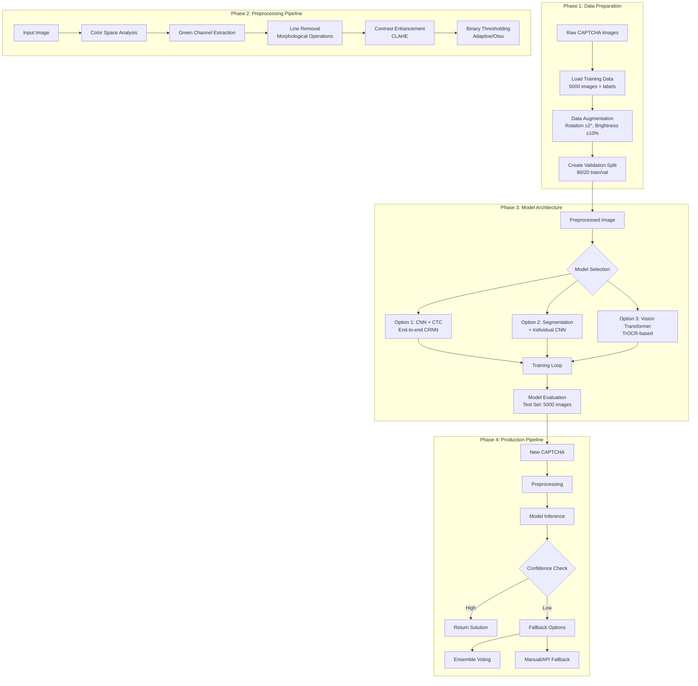

# ECI CAPTCHA Solver - Analysis & Strategy

## Deep Analysis of Provided CAPTCHAs

### Visual Pattern Analysis

After analyzing the 9 provided CAPTCHA images and their solutions, I've identified the following consistent patterns:

1. **Character Set**: 62 characters (a-z, A-Z, 0-9)
2. **Fixed Length**: Always exactly 6 characters
3. **Font**: Consistent serif font (appears to be Times New Roman or similar)
4. **Color Scheme**:
   - Text: Green (#00FF00 or similar)
   - Background: White
   - Diagonal line: Same green as text
   - Horizontal lines: Yellow, Cyan, Pink (consistent positions)

5. **Noise Elements**:
   - One diagonal line (bottom-left to top-right)
   - Three horizontal lines at fixed positions
   - No character rotation or warping
   - No background noise patterns

6. **Character Spacing**: Regular and predictable
7. **Image Dimensions**: Consistent across all samples

### Solution Patterns from CSV Analysis

From the consolidated CSV (10,054 samples):
- **Mixed case distribution**: Both uppercase and lowercase appear
- **Alphanumeric mix**: Average ~2-3 digits per CAPTCHA
- **No special characters**: Only alphanumeric
- **Case sensitivity**: Solutions preserve original case

## Proposed Solution Architecture



## Detailed Implementation Strategy

### **Stage 1: Preprocessing Module** (`captcha_preprocessor.py`)

```python
class CaptchaPreprocessor:
    """
    Removes noise and enhances CAPTCHA images
    """
    
    def remove_lines(self, image):
        # 1. Detect horizontal lines (yellow, cyan, pink)
        #    - Use color masking in HSV space
        #    - Morphological operations to fill gaps
        
        # 2. Detect diagonal green line
        #    - Hough transform for line detection
        #    - Differentiate from text using thickness
        
        # 3. Inpainting to restore text
        #    - Use neighboring pixels
        #    - Preserve character integrity
        
    def enhance_text(self, image):
        # 1. Increase contrast
        # 2. Sharpen edges
        # 3. Normalize brightness
```

### **Stage 2: Model Architecture Options**

#### **Option A: CRNN with CTC Loss (Recommended)**
```python
class CRNN_CTC_Model:
    """
    End-to-end recognition without segmentation
    Best for fixed-length CAPTCHAs
    """
    
    Architecture:
    - CNN Feature Extractor (ResNet/EfficientNet backbone)
    - Bidirectional LSTM/GRU
    - CTC Loss for sequence alignment
    - Output: 6 characters directly
    
    Advantages:
    - No segmentation needed
    - Handles overlapping characters
    - Proven architecture for OCR
```

#### **Option B: Segmentation + Individual Classification**
```python
class SegmentationModel:
    """
    Traditional approach with character isolation
    """
    
    Pipeline:
    1. Vertical projection for segmentation points
    2. Extract 6 character regions
    3. Individual CNN classifier (62 classes)
    4. Combine predictions
    
    Advantages:
    - Interpretable
    - Can visualize failures
    - Simple to debug
```

#### **Option C: Vision Transformer (Advanced)**
```python
class VisionTransformerOCR:
    """
    State-of-the-art using attention mechanism
    """
    
    Architecture:
    - Patch embedding
    - Transformer encoder
    - Character-level decoder
    
    Advantages:
    - Best accuracy potential
    - Handles complex patterns
    - Transfer learning from TrOCR
```

### **Stage 3: Training Strategy**

```python
class TrainingPipeline:
    
    def __init__(self):
        self.batch_size = 32
        self.epochs = 100
        self.learning_rate = 0.001
        self.optimizer = "AdamW"
        
    def data_augmentation(self):
        # Minimal augmentation (CAPTCHAs are consistent)
        - Random brightness: ±10%
        - Random contrast: ±10%
        - Slight rotation: ±2 degrees
        - Salt & pepper noise: 0.01 probability
        
    def loss_functions(self):
        - CTC Loss (for CRNN)
        - CrossEntropy (for segmentation)
        - Focal Loss (for imbalanced classes)
        
    def metrics(self):
        - Character-level accuracy
        - Sequence-level accuracy (full CAPTCHA)
        - Per-class F1 scores
```

### **Stage 4: Ensemble & Optimization**

```python
class EnsemblePredictor:
    """
    Combine multiple models for robustness
    """
    
    def predict(self, image):
        predictions = []
        
        # Model 1: CRNN
        pred1 = self.crnn_model.predict(image)
        predictions.append(pred1)
        
        # Model 2: Segmentation
        pred2 = self.segmentation_model.predict(image)
        predictions.append(pred2)
        
        # Model 3: Different preprocessing
        enhanced = self.aggressive_preprocess(image)
        pred3 = self.crnn_model.predict(enhanced)
        predictions.append(pred3)
        
        # Voting mechanism
        return self.weighted_vote(predictions)
```

## Implementation Roadmap

### **Step 1: Data Pipeline & Preprocessing**
```python
# File: data_loader.py
- Load and validate dataset
- Implement train/test/val splits
- Create data generators

# File: preprocessor.py
- Line removal algorithms
- Text enhancement
- Batch preprocessing
```

### **Step 2: Model Development**
```python
# File: models/crnn_ctc.py
- Implement CRNN architecture
- CTC loss integration
- Training loop

# File: models/segmentation.py
- Character segmentation
- Individual classifiers
- Ensemble logic
```

### **Step 3: Training & Optimization**
```python
# File: train.py
- Hyperparameter tuning
- Cross-validation
- Model checkpointing

# File: evaluate.py
- Performance metrics
- Error analysis
- Confusion matrices
```

### **Step 4: Production Integration**
```python
# File: captcha_solver.py
class ECICaptchaSolver:
    def __init__(self, model_path, fallback_api=None):
        self.model = self.load_model(model_path)
        self.preprocessor = CaptchaPreprocessor()
        self.fallback_api = fallback_api
        
    def solve(self, image_path, confidence_threshold=0.85):
        # Preprocess
        image = self.preprocessor.process(image_path)
        
        # Predict
        prediction, confidence = self.model.predict(image)
        
        # Confidence check
        if confidence >= confidence_threshold:
            return prediction
        elif self.fallback_api:
            return self.fallback_api.solve(image_path)
        else:
            return None
```

## Expected Performance Metrics

Based on the CAPTCHA characteristics:
- **Target Accuracy**: 95%+ (due to consistent format)
- **Inference Speed**: <100ms per CAPTCHA
- **Model Size**: <50MB
- **Training Time**: ~2-4 hours on GPU

## Key Success Factors

1. **Robust Line Removal**: Critical for accuracy
2. **Character Normalization**: Handle case variations
3. **Ensemble Methods**: Combine multiple approaches
4. **Confidence Scoring**: Know when to use fallback

## Next Steps

1. **Immediate Action**: Start with preprocessing experiments
2. **Quick Win**: Train a simple CNN on segmented characters
3. **Iterate**: Move to CRNN for better accuracy
4. **Optimize**: Ensemble and fine-tuning

This architecture leverages the consistent nature of ECI CAPTCHAs while building in robustness for edge cases. The modular design allows for incremental improvements and easy debugging.